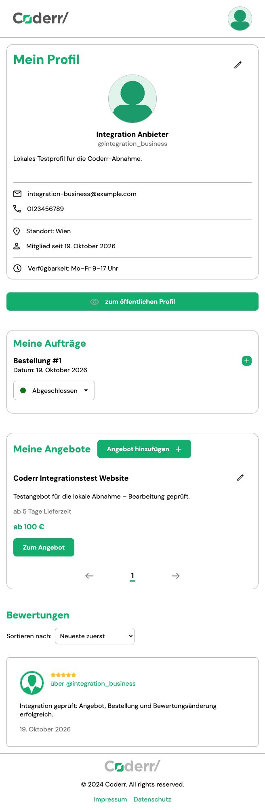

# Local verification report

Date: 19 October 2026 (Europe/Vienna).

## Result and limits

All 23 documented method/route combinations are implemented. The local suite
passes 97 tests. Core workflows were exercised through the unmodified course
frontend. This is a local development verification, not confirmation of the
external course PM tests or a production deployment review.

The course frontend was cloned into a sibling directory, outside this backend
repository. Tested upstream revision: `31d1e195d639e8bce91f87c5b330b9d040ef5c46`.
Its working tree was unchanged after testing. Local URLs were
`http://127.0.0.1:8000/api/` and `http://127.0.0.1:5500/`.

## Automated evidence

| Check | Result |
| --- | --- |
| Django tests | 97 passed |
| Combined statement and branch coverage | 98.67%, displayed as 99% |
| Statement coverage | 663 / 670 = 98.96% |
| Branch coverage | 79 / 82 = 96.34% |
| Django system check | No issues |
| Migration consistency | No model changes missing migrations |
| Database setup | Migrations applied locally; test database built from migrations |
| Ruff lint and format | Passed |
| Dependency consistency (`pip check`) | No broken requirements |
| Function/method length | At most 14 physical lines, including docstrings |
| Class/function docstrings | Present in non-migration Python source |
| Debug prints | None in application/test source |
| Admin smoke tests | Lists and change forms for every marketplace model render |
| Admin purchase protection | Order terms read-only, status editable, creation disabled |

Coverage includes `auth_app`, `offers_app`, `orders_app`, `reviews_app` and
`core`, including settings and admin. Only tests and migrations are excluded.
Remaining uncovered code: the WSGI entry point, development media URL setup
under the test runner, and oversized/unsupported-format offer image validation
branches. Valid uploads and fake images are tested for offers; the corresponding
profile limits also have negative tests. No artificial coverage exclusions were
added for these remaining lines. The HTML report is generated locally into
`htmlcov/` and is not committed.

## Browser workflow evidence

1. Homepage returned valid empty platform counters before test records existed.
2. Registered a business account and was redirected into the offer list.
3. Edited first/last name, contact details, location, description and availability.
4. Created an offer with basic, standard and premium packages and feature lists;
   premium unlimited revisions round-tripped correctly.
5. Edited the offer description and confirmed the saved value in its listing.
6. Registered a separate customer account and searched for the test offer.
7. Loaded the offer and package details and completed a local test purchase.
8. Confirmed the purchase in the customer's order list.
9. Created a five-star review and edited its description in the customer profile.
10. Logged out and signed in again as the business account using the login form.
11. Confirmed the business order list and changed the purchase to completed.
12. Uploaded a generated PNG profile avatar; both displayed profile images loaded
    successfully from the backend media URL after saving.
13. Homepage counters reflected one business, one offer, one review and rating 5.

The native file-input automation did not initially open the picker. Retrying
through the visible camera control selected the test PNG and completed the
upload. This was an automation interaction issue; no frontend/backend change
was required.



The browser run leaves synthetic local test data for inspection: two accounts
(`integration_business`, `integration_customer`), one offer, one completed order,
one review and a generated avatar. Nothing was published or sent to real users.
The database and media are excluded from Git. The frontend's predefined guest
credentials do not correspond to seeded backend accounts; normal registration
was used instead.

Browser evidence covers the core path above. The API suite additionally checks
filter/sort/page variants, deletion, malformed inputs, foreign-account writes,
role permissions, duplicate reviews, transaction rollback and purchase snapshots
surviving offer edits/deletion. It does not establish every possible browser,
concurrency, or production configuration outcome.

## Course checklist audit

| Requirement | Status and evidence |
| --- | --- |
| Documented endpoints | Implemented; route matrix in PLAN.md and API tests |
| At least 95% in the course PM tests | **Pending external verification**; PM test suite not provided |
| Single-responsibility functions, maximum 14 lines | Reviewed and AST length check passed |
| No debug prints or commented-out code | Source scan and review passed |
| PEP8 and documentation | Ruff passed; English docstrings present |
| English startup README and dependency files | Present; README covers installation and known specifics |
| Separate backend repository without frontend | Local repository prepared; frontend is a sibling checkout |
| Backend uploaded to its own GitHub repository | **Pending**; no remote repository configured |
| No database in Git | Database, journals, media and local environment excluded |
| `core` project and clearly named apps | Present |
| App-specific `api/` packages and URLs | Present; included centrally |
| Usable Django admin | Verified by automated list/change-form smoke tests |
| Model naming, relations, string representations | Reviewed; explicit related_name and on_delete |
| Model responsibilities | Data definitions/constraints plus string representations |
| ModelSerializer for CRUD with explicit fields | Present; small input/query serializers use Serializer |
| CRUD views and individual endpoints | Offers use ModelViewSet; orders/reviews use only documented mixins; custom counters/statistics use APIView |
| Querysets, serializer classes, scoped lists | Declared; participant order list uses get_queryset |
| Explicit auth, permissions and HTTP statuses | Implemented with regression tests |
| Imports grouped/sorted | Ruff import checks passed |

Specification decisions requiring awareness remain recorded in PLAN.md and
README: duplicate reviews use 403, review edits are author-only without staff
override, and ratings use a 1-to-5 scale. Optional profile text returns empty
strings. Old replaced/deleted image files are not automatically cleaned up.

## Reproduce local checks

From the backend directory with its virtual environment activated:

```bash
python manage.py check
python manage.py makemigrations --check --dry-run
python -m ruff check .
python -m ruff format --check .
python -m pip check
python -m coverage run manage.py test
python -m coverage report -m
python -m coverage html
```

To complete the submission checklist, run the actual course PM tests and
publish the backend to the user's chosen GitHub repository. Local coverage is
not a substitute for that external test result.
